# Content Architecture: Visual Guide for Discussion

> **Technical appendix.** For a shorter and less technical explanation, start with the [illustrated Content Architecture overview](2026-11-04-content-architecture.md). For the **latest researched recommendations and unanswered product decisions**, see [Six Architecture Decisions](2026-11-05-architecture-decision-series.md). Older diagrams and interfaces below remain candidates, not authoritative final implementations; **the listed types are responsibilities, not eleven mandatory Dart classes.**

## Quick visual orientation

| What you want to understand | Diagram |
| --- | --- |
| What is a Post or Group? | 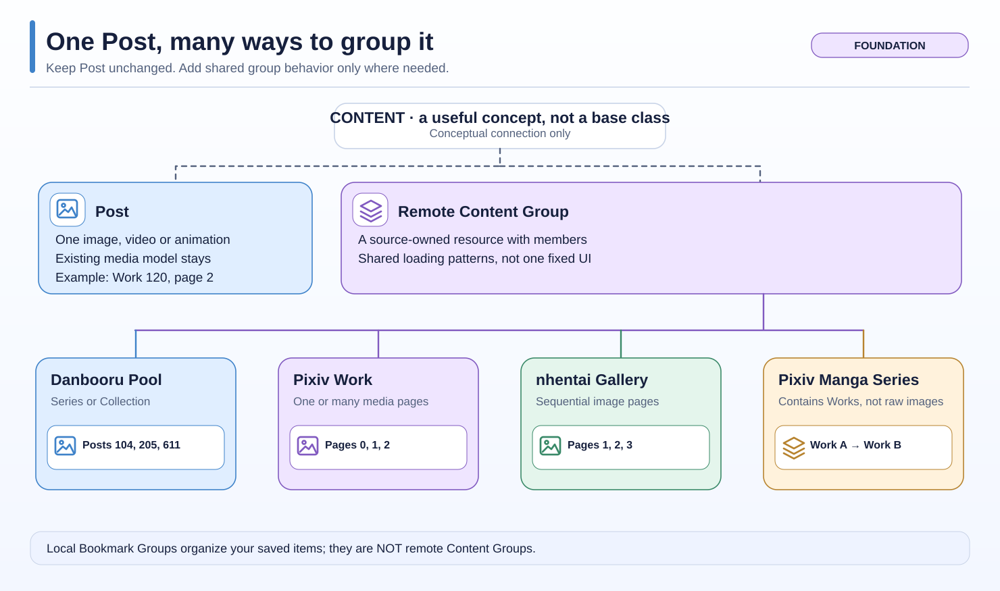 |
| How can a Series contain Works and Pages? | 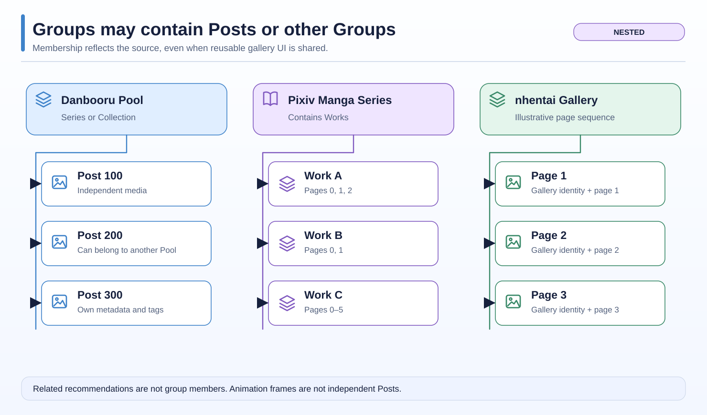 |
| Which layer loads and displays information? | 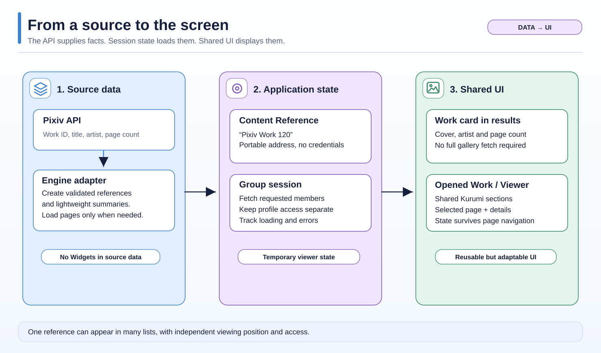 |
| What are Work actions versus Page actions? | 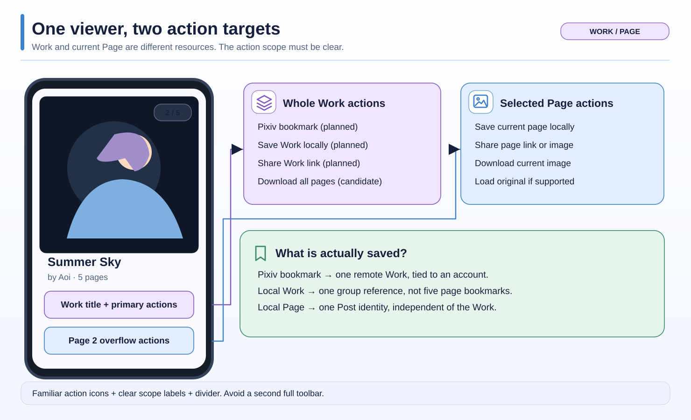 |

**Simple mental model:** a Post is an individual media item. A Content Group is a source-defined object with members. A Content Reference is its portable address. The session loads data using an authorized profile; the ViewerEntry remembers one position in the viewer; local Bookmark Groups store separate memberships. Neither the graphical hierarchy nor `Content` implies Dart inheritance.

**Distinguish facts and plans:** the existing `Post`, mixed Viewer, Pool and local bookmark mechanisms are real. The generalized reference/member contracts, group-level Pixiv Actions and universal presentation composition remain proposed. Remote recommendations such as Pixiv Related Works are not group members.

The original detailed diagrams and type table follow below as evidence and design candidates.

---


Date: 2026-11-04. Baseline: `e306ff5338a2255a89731c61bd0672336a933344`.
**Status: proposed type names and boundaries, not an approved runtime specification.**

Read [the feedback supplement](2026-11-04-content-architecture-feedback.md) for accepted user constraints. The examples below explain the proposal before implementation. Android is primary. Stabilize existing work first; architecture implementation precedes the remaining Pixiv/nhentai features.

## 1. The idea in one picture

`Content` is a word for what the user can browse. It does not have to become a superclass.

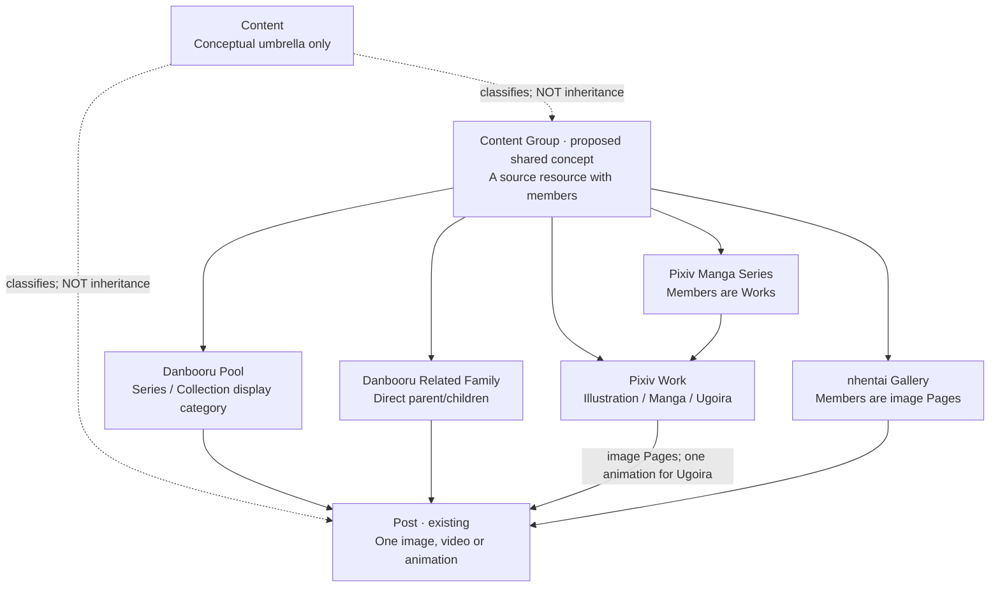

This is a **semantic classification and membership diagram**, not a Dart inheritance tree. The same actual Post can appear in several collections. A Manga Series is not a flat list of all images across all Works. An animation is not a collection of frame-Posts.

Local **Bookmark Groups** organize user memberships. They do not inherit from, or become, remote Content Groups. Source recommendations such as Pixiv Related Works are another separate relationship.

## 2. Proposed implementation shape: composition over a new base class

A mixed listing may need a narrow discriminated entry type. Existing Post-only APIs do not automatically change.

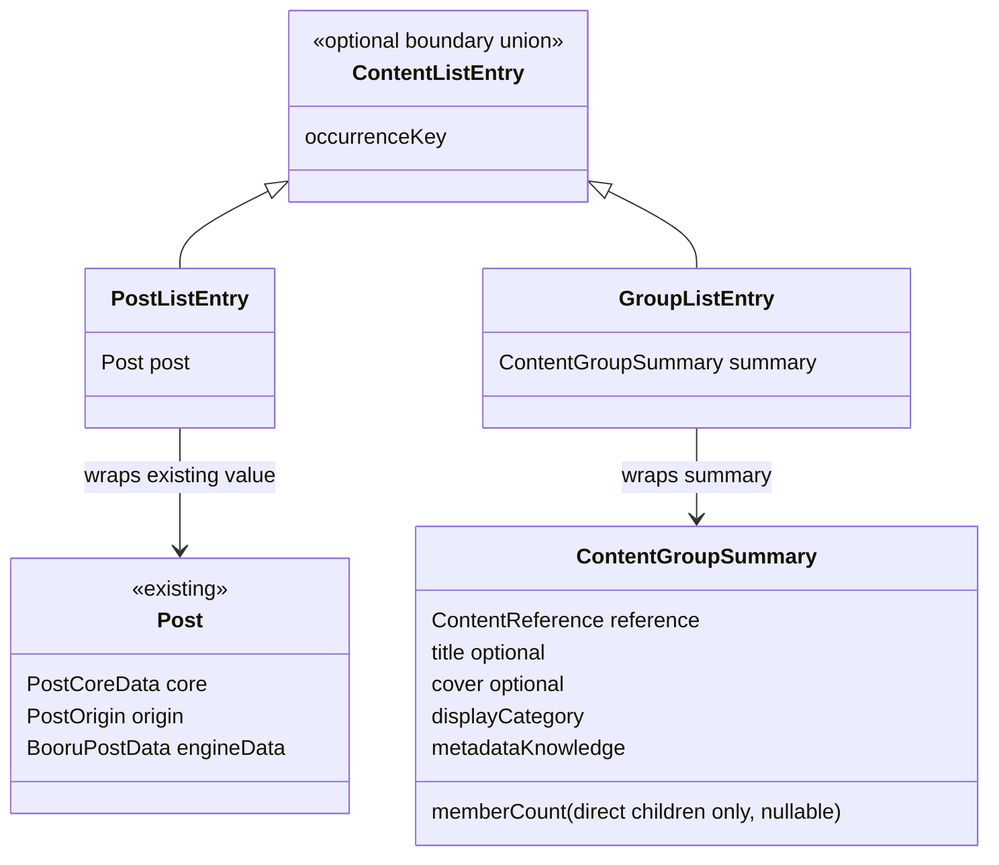

Only the listing wrappers are variants of the new boundary union. **Post does not inherit from ContentListEntry.** A Post still flows unchanged through media resolution, file details, ordinary downloads, snapshots and existing Post-only repositories. Use this union only where native mixed/group results actually require it; do not mechanically replace every `List<Post>`.

The existing `ViewerEntry` remains the transient viewer-occurrence contract. Listing entries adapt to it; it should not become the persisted source model.

**Updated member-count convention (2026-11-06):** Only direct members count: Series → Works, Work/Gallery → Pages, Pool → Posts. Use one nullable `memberCount`; derive the unit from direct member semantics. Do not store an aggregated Page count on a Manga Series Summary. See [the concrete fields and their source payloads](2026-11-06-content-group-summary-details-candidates.md).

## 3. Data types and their proposed properties

| Type or concept | Properties/responsibility | Not allowed inside |
| --- | --- | --- |
| `ContentReference` | Engine, normalized source address, stable resource kind, validated source key | Credentials, Widget, controller, local membership, media URL as identity |
| Derived `ContentIdentity` | Canonical namespace + stable kind/key, using only verified alias rules | Viewer index, mutable category/title, active profile |
| `Post` | Existing media, tags, source facts and engine payload | A fake group disguised with dummy media fields |
| `ContentGroupSummary` | Reference; nullable title/safe cover; known direct memberCount; semantic display category; metadata provenance | Eager full member list, user save date |
| `ContentGroupDetails` | Summary plus typed source-owned fields (artist, description, statistics, relationships) | UI builders or automatic full-library loading |
| `GroupMember` | Content reference; member key/source position; availability; optional hydrated Post or child-group summary | Renumbered position after filtering |
| `GroupMemberPage` | Bounded member results; source continuation; end-of-list evidence; known totals if supplied | Assumption that empty visible results imply exhaustion |
| `GroupSession` | Access/policy-bound requests, order, continuation, cancellation and revision | Exported auth, global profile mutation |
| `ViewerEntry` | Occurrence ID, reference/payload adapter and transient source binding | User data persistence |
| Bookmark membership | Local group ID, saved-item identity, per-membership date and existing Undo semantics | Source-owned metadata or canonical identity fields |
| `GroupPresentation` | Engine-registered card/details sections and supported composition | API transport, persistence migration, credential selection |

These are architectural responsibilities. Not every row needs a separate public class on day one. For example, derived identity may be a value/accessor on the validated reference; a member page may reuse an existing page container where its semantics match.

### Resource kind is not the badge label

Examples of **illustrative**, not finalized, reference forms:

```text
engine=danbooru  site=danbooru.example       kind=pool        key=id:42
engine=danbooru  site=danbooru.example       kind=related     key=anchor:17
engine=pixiv     site=pixiv.net             kind=work        key=id:120
engine=pixiv     site=pixiv.net             kind=work-page   key=120:2
engine=pixiv     site=pixiv.net             kind=manga-series key=id:9
engine=nhentai   site=nhentai.net           kind=gallery     key=id:800
engine=nhentai   site=nhentai.net           kind=gallery-page key=800:7
```

Existing wire keys, including `work-page:<workId>:<index>` in current Post sharing/bookmarks, must remain accepted. This illustration is not approval to change their spelling or page-number convention. nhentai `PageInfo.number` needs source verification before encoding its exact key. Engine registration validates kind/key combinations; arbitrary strings are not permission to request arbitrary endpoints.

Changing a Danbooru Pool badge from Collection to Series does not change its Pool identity. A route displaying the same content twice uses different occurrence IDs.

## 4. How data, state and UI interact

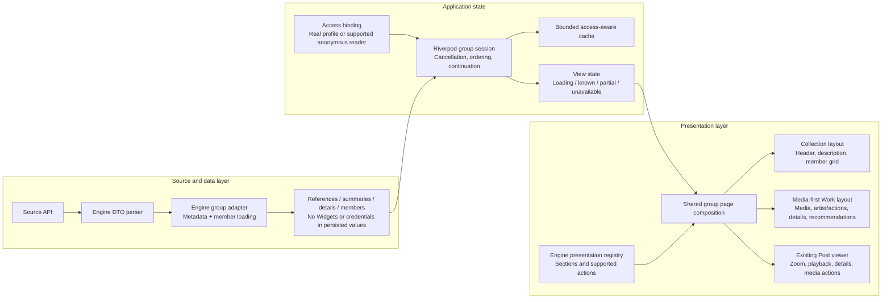

Dependency direction: Widgets consume state; sessions call data capabilities. An API repository does not construct a Widget. Engine UI registrations may compose existing Danbooru-style sections. Data adapters must not hardcode Kurumi colors or layout.

The current repository hook returning Widgets can be adapted during extraction rather than rewritten across unrelated engines. The new boundary should stop extending that coupling.

The shared page owns common layout/lifecycle, not a mandatory single visual order for all resources. A Pool can remain description-first; a Pixiv Work can be media-first. Reuse sections and behavior rather than forcing visually identical whole screens.

## 5. Three independent identities

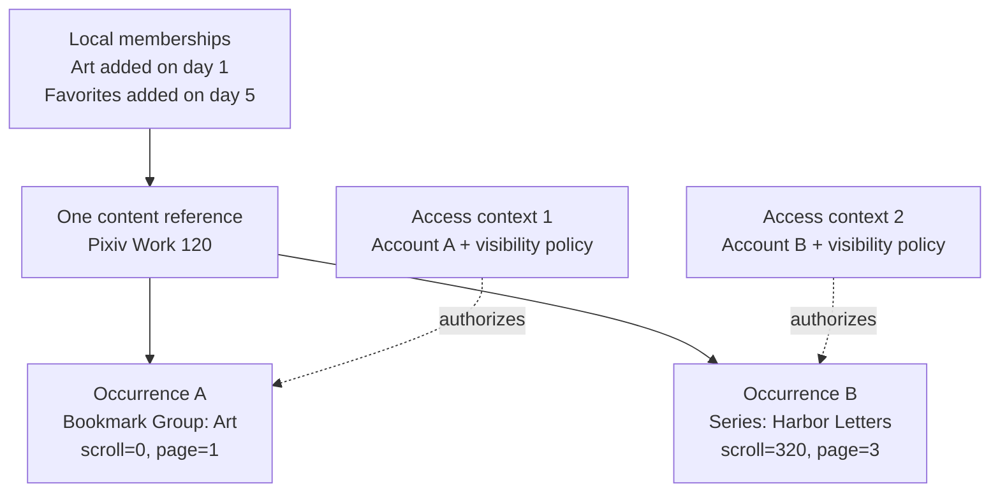

A canonical reference is reusable. Cached private data is not necessarily reusable across both accounts. Saved membership dates do not change when remote details refresh. A later API result from Account A cannot update Account B's session.

## 6. Nested groups and missing pages

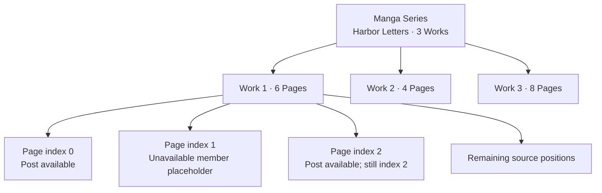

Back returns through an explicit route stack and restores each occurrence's scroll/page. Missing members retain source positions; they do not become fake Posts and do not shift later identities. Loading a Series does not eagerly fetch every Work and image. The first implementation needs nested references and bounded member opening, not a generic infinite tree renderer.

Single-image Work: preserve its Work identity and metadata, but avoid an empty extra gallery step. Ugoira: one playable media item; its internal frame list is not shown as pages.

## 7. Work membership versus related content

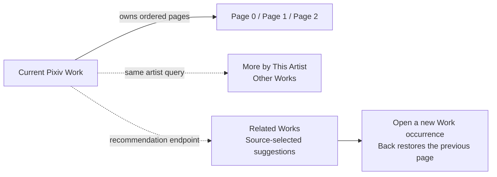

Artist and related sections can share Danbooru's lower related-content presentation. Their data sources remain distinct. They are not new parent/child groups and are not persisted as the current Work's members. An optional recommendation failure cannot fail primary media or details.

The current Pixiv client lacks a related-Work method. Independent client code supports `/v2/illust/related`; authenticated Boorusama validation remains required. See the research supplement for parameters and evidence.

## 8. One visible page, different action targets

| UI action | Target when viewing Pixiv Work 120 / Page 2 |
| --- | --- |
| Save This Page | Local page reference, original page index retained |
| Save Work | Local Work reference; does not create six page bookmarks |
| Favorite on Pixiv | Work ID 120 plus selected account/public-private state |
| Download Image | Page 2's resolved original/media choice |
| Share Work Link | Lightweight Work reference, no local groups or credentials |
| Share Page Link | Existing stable Work/page reference |
| Open Artist | Stable creator identity, not display-name inference |

Resolve targets through source capabilities. Avoid duplicating ad hoc `if Pixiv` checks in every shared button. The operation target may differ from the currently displayed Post; action availability also depends on the access context.

## 9. Persistence and sharing flow

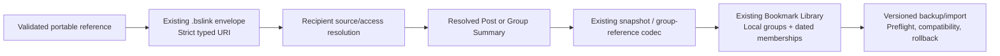

Do not embed complete member databases in bookmark records. Optional metadata caches and user bookmarks have different lifecycles. Preserve v9 membership semantics, legacy Pool/Related keys and opaque/unsupported-data safety. Canonical aliases never authorize cross-host credential use.

## 10. UI compositions to compare

### A. Cover First

Large first image -> artist/action row -> details -> More by Artist / Related Works. Tapping the cover opens the existing media viewer for all pages. Low gesture conflict and obvious group boundary; entering the viewer costs a tap.

### B. Inline Gallery

Large swipeable preview with page indicator -> same artist/action/details sections. Expand opens the existing media viewer. Fast page sampling, but inner-page versus outer-Work horizontal gestures require an explicit ownership rule. This is a lightweight preview pager, not an independent nested full viewer.

### C. Viewer + Details

Open directly into the existing media viewer with compact Work identity; reveal details with the established sheet interaction. Best image focus and least extra navigation. Work-level versus page-level actions and returning to a parent Series need particularly clear UI.

A normal Pool continues Header/description/member grid. A Manga Series uses Work cards. An nhentai Gallery can use cover/details/page grid or a media-first entry based on the same references; reader/reading-direction preferences are a later explicit decision.

No variant is silently selected as final. The accompanying standalone prototypes let the user compare these behaviors before approval.

## 11. Architecture acceptance boundaries

Do not start application implementation from this diagram alone. First agree: final reference schema; exact source/member semantics; preservation of current Post identities; access/policy rules; selected Work composition; actual stabilization baseline. Then extract only proven shared behavior.

Test at least: same resource twice; multiple installations under one host; Pool category changes; missing middle pages; group metadata without members; incomplete manifests; nested Works; animation frames; account replacement; metadata refresh without membership-date changes; obsolete/new backup types; per-operation target selection; native Gallery results without fake Posts; bounded optional related loading.

The visual guide deliberately distinguishes an existing `Post`, proposed shared values, transient state and Widgets. The goal is a coherent experience with engine-specific capabilities, not a new framework for its own sake.
