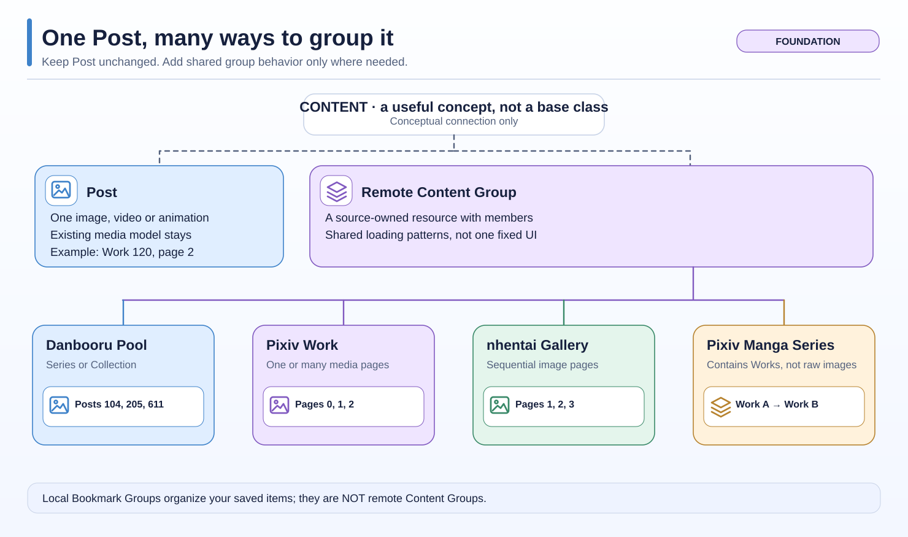
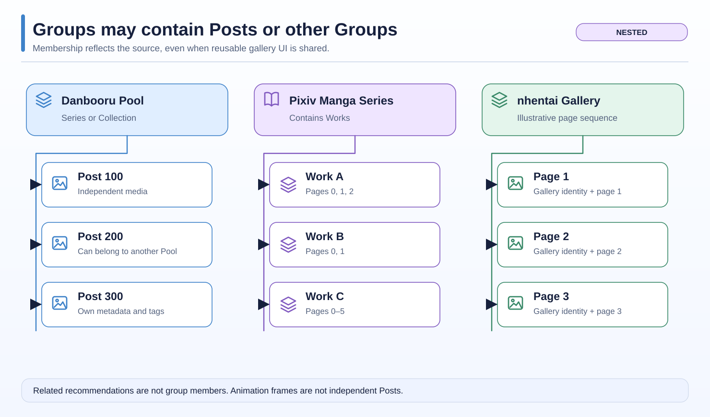
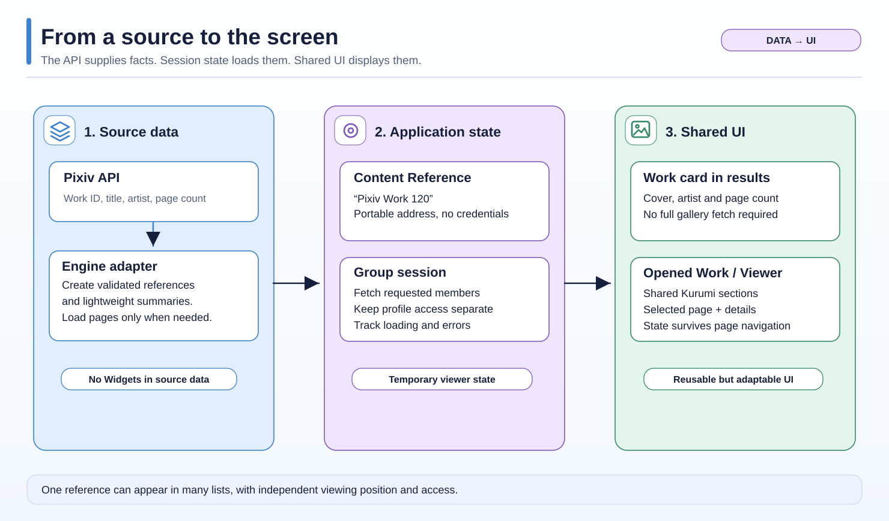
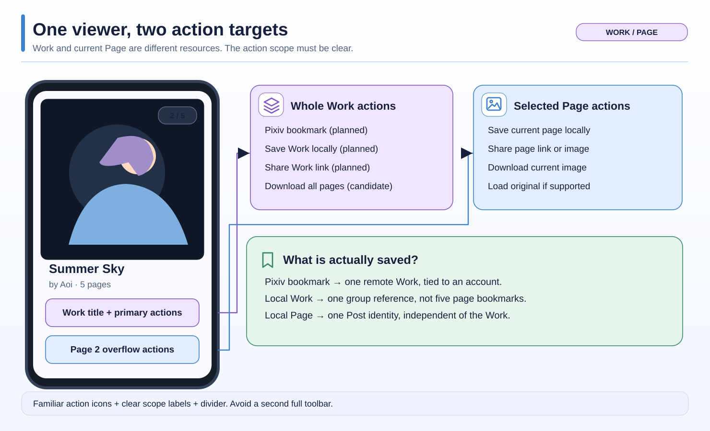

# Content Architecture — Start Here

> **Discussion draft · 5-minute overview.** These diagrams describe a proposed architecture, **not functionality already implemented in Boorusama**. The code examined for this design is `develop` at `e306ff533`. Later decisions can change the designs; the deeper technical notes are retained below.

**The central idea:** keep `Post` as one image, video or animation. Add just enough shared **group behavior** so a Danbooru Pool, a Pixiv Work, a Pixiv Manga Series and an nhentai Gallery can reuse navigation, bookmarks and viewer components without needing separate implementations for every website.

## 1. What exactly is a Group?

A **Post** remains a single media item. A **remote Content Group** is something from the source website that contains one or more members. Members might be Posts or other Groups.

For example:

| Source object | What it contains | What it means to users |
| --- | --- | --- |
| **Danbooru Pool** | Independent Posts | Series or Collection is a **category of the same Pool**, not a separate technical model |
| **Pixiv Work** | One or more image Pages, or one Ugoira animation | One artwork with a title, artist, description and Work-level actions |
| **Pixiv Manga Series** | Other Works | Opening a Work then exposes its own Pages |
| **nhentai Gallery** | Ordered image Pages | Same shared group idea; no separate core Gallery UI is required |

**Local Bookmark Groups are different.** They are your own folders/group memberships, not remote groups owned by a site. One Post or Work can be stored in several of them.

These names describe **what the website provides**, not a requirement for four separate Dart subclasses or four unrelated gallery screens.

## 2. Groups inside Groups

Imagine a Pixiv Manga Series named *Summer Stories*:

- **Series** contains Work A and Work B.
- **Work A** contains pages 0, 1 and 2.
- **Work B** contains pages 0 and 1.
- You can open either Work without loading every image in the entire Series.

Danbooru Pools instead point to independently existing Posts. A Post may be in several Pools. A recommendation such as **Related Works** is a separate link, **not another page in the current Work**. Ugoira animation frames are **not** individual Posts.

**This is why we reuse group *behavior*, not force every source into exactly the same member type.**

## 3. From an API to the screen

Think of three responsibilities:

1. **Source adapter:** asks Pixiv, Danbooru or nhentai for facts. It understands that website's IDs, tags, membership and pagination.
2. **App state:** knows which content is open, which profile may access it, what has loaded, and which position you are viewing. It cancels outdated requests.
3. **Shared UI:** assembles familiar Kurumi components, the media viewer and relevant details. A Pool can be description-first; a Pixiv Work can be media-first.

We need a few small pieces of information between these layers, **not eleven new public classes**:

| Name | Plain meaning | Example |
| --- | --- | --- |
| `ContentReference` | The saved/reopenable address | “Pixiv Work 120” |
| **Group summary** | Data to show a card without opening every page | Cover, title, known count |
| **Group members** | Items and source positions inside that group | Work 120, page 2 |
| `ViewerEntry` | One occurrence in the opened viewer | The same Work opened twice in one mixed list |
| **Bookmark membership** | A local saved relationship, with its date | Work 120 saved to “Art” on Monday |

A separate **identity** can usually be derived from the reference. A session is **temporary controller/Provider state**, not another saved content record. Summary and details may be two loading phases rather than two mandatory classes.

### Why does `ContentListEntry` exist in the diagrams?

Only for a list that can mix media and groups. In `[single image, Pixiv Work card, Danbooru Pool card]`, each *visible position* is a list entry. `PostListEntry` wraps a Post; `GroupListEntry` wraps a small group summary. They are variants of `ContentListEntry` **if that wrapper is really needed**. We will not replace every ordinary `List<Post>` in Boorusama.

## 4. A Work and its current Page have different actions

Example: a Pixiv Work has five pages and you are viewing **2 / 5**.

- **Work:** Pixiv bookmark (whole Work, account-bound); locally save Work; share Work reference; possibly download all pages.
- **Current Page:** locally save this image only; share its link or image; download it; load the original where available.

**UI direction under discussion:** keep a few Work-level actions near the Work title. Put less frequent Page actions into the existing overflow, using familiar icons and a divider between **Work** (stack icon) and **Current Page** (image icon). No second persistent action toolbar or new unexplained bookmark icons.

The current local Post bookmarking and sharing already supports Pixiv page identities. **Work bookmark sharing and Pixiv server-side bookmark writing are future features**, not already delivered by this diagram.

## 5. How would viewing feel?

We are leaning toward a **media-first Work**:

- **Image View:** centered, immersive image with a small page counter when applicable.
- **Overview:** same selected image, followed by artist/avatar, main Work actions, description, tags and related recommendations.
- Swipe **on the image** to change Pages; swipe **on the Overview description/details area** to switch whole Works. No two-finger Work-skip and no permanent previous/next app buttons.
- Tall comics should retain reading position when returning from Overview; wide images should keep their proportions.

The exact transitions, auto-hide behavior, overview preview-height limit and interaction details are **still being evaluated**.

[Open the interactive Image View / Overview Lab](mockups/2026-11-04-viewer-interaction-lab.html) (download the single HTML file and open it locally). It supports your own images, 2.2:1 phone simulation, live zoom and observation export.

## 6. What is decided, and what is still open?

**Agreed direction:** keep existing `Post`, keep the Mixed Viewer and snapshot/bookmark foundations, avoid a universal new `ContentItem` superclass, reuse Danbooru/Kurumi visual components, and reuse existing `.bslink` sharing infrastructure with stable content references. Android is the primary target. **Finish existing work and bugs, then implement group architecture, then add remaining Pixiv/nhentai features.**

**Still to decide together:**

- Exact shared reference/group/member contract and minimal number of new types.
- Final Work layout/gesture handling and how Work actions differ from Page actions.
- Pixiv Series/user-search and related recommendations after authenticated API checks.
- nhentai access/CDN verification and staged tag-catalog synchronization.
- Migration and handling of unsupported future bookmark/snapshot records.
- Aspect-aware double-tap zoom values, informed by real-device measurements.

This document is a **design review**, not a go-ahead to implement the architecture.

## Technical details and historical research

You do **not** need these for the first read. They preserve implementation evidence, edge cases and earlier options:

- [Technical Visual Guide — proposed types, identity and state](2026-11-04-content-architecture-visual-guide.md)
- [Pool/Series terminology and viewer navigation clarifications](2026-11-04-content-model-and-viewer-clarifications.md)
- [User feedback and Pixiv/nhentai research](2026-11-04-content-architecture-feedback.md)
- [Full Architecture Rereview](2026-11-03-content-architecture-rereview.md)
- [Interactive original A/B/C and Favorites layout comparison](mockups/2026-11-04-content-design-lab.html)
- [Diagram authoring workflow](diagram_style_guide.md)

The visual examples use invented IDs, titles and counts. Their source-level semantics are grounded in the accompanying technical notes. No runtime implementation, API verification or device acceptance follows from these mockups.
