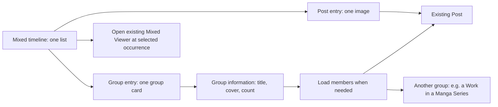

# Content Model and Viewer: Clarifications After User Review

Date: 2026-11-04. Runtime baseline: `e306ff5338a2255a89731c61bd0672336a933344`.
Discussion branch: `maintenance/content-architecture-design`.

This supplements the [visual guide](2026-11-04-content-architecture-visual-guide.md). It clarifies the proposal; it does not authorize application implementation or finalize gestures, type names, zoom limits, or Work layouts. Existing stabilization work still precedes the architecture rollout. Android remains primary; desktop is optional.

## 1. Pool, Series, Collection and Gallery are not four required implementations

**Confirmed source finding:** Danbooru Series and Collection use the same `DanbooruPool` type, ID space, description and member-list structure. Category is a field, not a separate class. Both map to `RemoteBookmarkPool` with upload-order support. However, `DanbooruPoolBookmarks.getBookmarkSeries` deliberately admits only Series into the automatic nearby-post grouping lookup. Therefore category is meaningful even though loading and gallery rendering are shared.

The source concepts differ in intent: a Series represents an ordered sequence; a Collection groups posts by a theme. A common implementation can preserve both. Changing the category must not create a new bookmark identity.

An nhentai Gallery should reuse the same shared group contracts and reusable UI. `gallery` in the previous diagram described a source resource, not a requirement for a separate shared class, screen, badge or global group-kind hierarchy. The engine already identifies the site integration; we do not need another UI type merely to distinguish websites.

Keep three questions separate:

| Question | Example | Owner |
| --- | --- | --- |
| How is the source object addressed? | Danbooru Pool 42; nhentai Gallery 42 | Engine reference validation and loader |
| What is its meaning? | Ordered story, thematic collection, artwork | Source metadata/category |
| How should it be shown? | Member grid or media-first Work view | Shared presentation composed with engine capabilities |

A Danbooru Pool may reference independent posts 100 and 200, each also present elsewhere. A Gallery page may only have a stable address together with its Gallery and page number. That affects identity/loading, not whether we can reuse a card or viewer. Native resource discriminators remain useful where one engine exposes overlapping Work and Series IDs. They need not become one new Core class per source. No persisted keys or link types are being renamed here.

## 2. The small mental model

Start with only **content**, **an address**, **a place in a list**, and **the current screen state**.

In the proposed class diagram, `PostListEntry` and `GroupListEntry` really are variants/subclasses of `ContentListEntry`. They describe **one place in a mixed list**, not a new kind of Post. Example: `[photo, Series card, illustration]` is three entries. It is not a list of all images hidden inside the Series.

Use this small wrapper only at a genuinely mixed/native-group listing boundary, such as mixed Bookmarks or future Work results. Do not wrap every existing Post-only API. Adapt it to existing `ViewerEntry` where the viewer needs its own occurrence/state. Prefer an existing equivalent entry type over introducing duplicate wrappers with identical information.

### What the larger table was trying to explain

| Proposed term | Plain-language job | Concrete example | Simplification |
| --- | --- | --- | --- |
| ContentReference | Address needed to reopen content | Pixiv Work 120 on pixiv.net | One small validated value |
| ContentIdentity | Determine whether two addresses represent the same content | Two local groups saved Work 120 | Can be derived from the reference; not necessarily another stored object |
| Post | Existing individual media item | Page 2 of Work 120 | Keep the established model |
| GroupSummary / GroupDetails | Small card information versus information loaded on opening | Cover/count first; description/artist later | Separate loading responsibilities; may be one progressively populated record rather than two public classes |
| GroupMember | One membership with its original position | Work 120 contains page index 2, even if index 1 is unavailable | A page is not renumbered after filtering |
| GroupMemberPage | One batch of members plus continuation | Next 20 Works in a Series | Reuse a compatible pagination container |
| GroupSession | The temporary loading/order state of an open group | Current sort, next batch, cancelled old request | Existing Riverpod/controller state may provide this; not a persisted model |
| ViewerEntry | One occurrence in the opened viewer sequence | The same Work opened from two different list positions | Extend the existing contract |
| BookmarkMembership | User saved this item into this local group at this time | Work 120 added to Art yesterday | Existing library responsibility, not a new store |
| GroupPresentation | How shared UI displays source information | Artist avatar row plus shared description/tags | Engine UI registration, not another content object |

The previous table listed responsibilities, not eleven mandatory new public classes. Implementers should justify every separate type by an actual boundary or invariant.

## 3. A, B and C: what is and is not settled

A requires opening the cover before paging through members. B already pages in the inline media area. Both can lead to a focused media viewer. C is closest to today's media-first viewer plus details sheet, but a Work-level identity, independent Work/Page actions and hierarchical navigation are not already delivered merely by that resemblance.

The original A/B/C mockup did not establish outer Work navigation. In particular, it did not prove how a horizontal inner gallery and the horizontal mixed viewer can both own the same gesture.

**New user constraints:** no persistent on-screen previous/next navigation buttons in the application; horizontal member navigation, not vertically stacked Work pages; images should remain central and prominent; compare very tall and very wide images; prefer B over A, with C only partly satisfactory.

### Proposed experiment: Image View and Work Overview

- **Image View:** one centered image; Comic mode may intentionally show a readable top-aligned crop. No title/metadata competing with it.
- **Work Overview:** the same selected image remains above artist/actions/description/tags and lower related sections. Tap the image to return. Do not create another route or decode/reload the same image merely to toggle.
- A tap toggles the two states. A double-tap zooms without first opening Overview. Gesture arbitration therefore needs to delay/cancel the single-tap action.
- Page navigation retains the current view mode. Initial-controls preference is evaluated only when opening the route, not on every page change.
- Viewport changes must preserve an intentional image point/reading position; never blindly reuse the same pixel transform for a smaller preview. Remember Image View zoom/pan while Overview uses a bounded full-image preview.

These labels are proposals. A generic Post can use `Overview`; `Work Overview` is the explicit name in Pixiv examples.

### Separate page navigation from skipping a Work

There is no unambiguous way for the same ordinary horizontal image swipe to mean both next image and skip all remaining images. A second deliberate interaction or context is necessary.

Compare two experiments, not approved production behavior:

1. One-finger image swipe changes a member. In Work Overview, horizontal swiping on a non-interactive metadata area changes the outer Work. This permits skipping without inspecting every page, but takes a tap from Image View.
2. The same behavior plus an optional two-finger parallel horizontal swipe in Image View to skip a Work. This needs actual Android pinch/zoom and accessibility acceptance before adoption; it must not trigger during a pinch or steal system-edge navigation.

Do not implicitly cross to another Work after the last member in this experiment. A page swipe stops at the member boundary. A deliberate Work action changes Work and preserves the previous Work's page for returning. Automatic cross-boundary navigation can be compared later, but it is not silently assumed.

No edge-swipe shortcut is proposed: Android Back already uses screen edges. No fast/long one-finger swipe heuristic is proposed: it would make ordinary page changes and panning unpredictable. Desktop buttons belong outside the simulated phone; keyboard and assistive actions are separate from persistent on-screen application controls.

### Aspect-ratio cases

| Content | Image View | Work Overview | Return |
| --- | --- | --- | --- |
| Normal / square | Centered contain fit | Bounded uncropped preview above details | Restore previous image view |
| Panorama | Centered contain fit; user zoom/pan | Entire width, no forced stretch or fake crop | Restore chosen focal point/zoom |
| Very tall comic | Existing readable fit-width mode when enabled | Bounded full-strip preview, so metadata is not thousands of pixels away | Restore reading position, not always comic top |
| Missing page | Stable unavailable slot | Same page position and Work metadata | No renumbering |

The full-strip Overview preview is deliberately a context/thumbnail view, not a readable comic. Users read it in Image View. This tradeoff must remain visible in the mockup.

## 4. Classic zoom: actual code versus candidate

Confirmed current constants: fixed target 3.0 and aspect-mismatch threshold 3.0. From an identity transform, Classic uses 3x for ordinary shapes and the exact other-dimension fit only when the ratio mismatch exceeds 3. If already transformed (including a pan or Auto Comic transform), it resets to the identity matrix. Thus Classic already has an aspect-aware extreme-image path; describing it as always fixed 3x was incomplete.

For a **400 x 800 usable media viewport**, before runtime constraints:

| Image | Current Classic first target from contain | Exact other fit | Bounded experiment (floor 1.35, cap 4) |
| --- | ---: | ---: | ---: |
| 1200 x 1800 portrait | 3.00 | 1.33 | 1.35 |
| 1000 x 1000 square | 3.00 | 2.00 | 2.00 |
| 1600 x 900 landscape | 3.56 | 3.56 | 3.56 |
| 4000 x 1000 panorama | 8.00 | 8.00 | 4.00 |
| 1000 x 2000 viewport-matched | 3.00 | 1.00 (no zoom) | 1.35 |

The proposal preserves the two-state interaction, not the fixed normal-image factor. The floor prevents an imperceptible/no-op zoom near a matching aspect ratio; a cap limits extreme panorama magnification. Both numbers remain experiments, not approved defaults. A floor of 1.35 slightly crops a 1.33 exact fit: compare a lower floor or tolerance-based exact-fit preference before deciding. Max zoom and actual decoded media bounds also need integration, not only the ratio formula.

Auto Comic is an explicit unresolved baseline choice. Current Classic resets an already auto-fitted comic to contain on its next double-tap. The earlier lab instead used a reading baseline and an extra detail step, even when `Current Classic Reference` was selected. That was not a faithful comparison for Comic mode and must not be cited as current behavior. New experiments must label this difference. Snap to Fit is a separate pinch-finish behavior.

## 5. Favorites scope recommendation

Prefer the **compact Timeline Toolbar selector** (`Public` / `Private`) as the best fit for the existing division of responsibilities: list filtering belongs with list controls. It removes the extra row, keeps the selected privacy scope explicit, and follows the same hide/reveal/persistence rules as other toolbar controls. Its returning on upward scroll does not cost an additional row.

A Header menu is the second choice if actual narrow-screen evidence shows toolbar crowding; it must still make the selected scope visible. The top-only segmented row is familiar but spends a whole row on an infrequent two-way choice. This is a recommendation, not a user-approved relocation.

The existing Favorites code uses a separate `KurumiSegmentedButton` sliver followed by `TimelineHeaderSliver`. Keep source/account isolation, cancellation and scope restoration on changes. Do not add `All` until the endpoint or a correct combined pagination strategy is verified.

## Sources

- [Current Pool model](https://github.com/timberpile/Boorusama/blob/e306ff5338a2255a89731c61bd0672336a933344/lib/boorus/danbooru/pools/pool/src/types/danbooru_pool.dart)
- [Category mapping and Series-only grouping](https://github.com/timberpile/Boorusama/blob/e306ff5338a2255a89731c61bd0672336a933344/lib/boorus/danbooru/pools/bookmarks.dart)
- [Danbooru pool API](https://safebooru.donmai.us/wiki_pages/api%3Apools)
- [Classic and Fit Cycle implementation](https://github.com/timberpile/Boorusama/blob/e306ff5338a2255a89731c61bd0672336a933344/packages/kurumi/lib/src/components/interactive_viewer.dart#L526-L715)
- [Current viewer media/preview/details composition](https://github.com/timberpile/Boorusama/blob/e306ff5338a2255a89731c61bd0672336a933344/lib/core/posts/details_pageview/src/post_details_page_view.dart#L601-L713)
- [Current Pixiv Favorites scope layout](https://github.com/timberpile/Boorusama/blob/e306ff5338a2255a89731c61bd0672336a933344/lib/boorus/pixiv/favorites/page.dart#L70-L132)

All code findings are inspection results, not new Flutter/device test results. Proposed interactions require user approval and Android verification.
