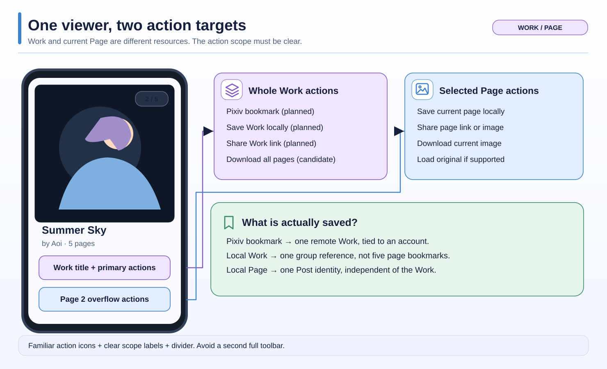

# Work and Current Page Actions — UX Options

**Later user feedback supersedes the older three-way comparison below.** The latest compact preference and researched behavior are in [Decision 2: Work/Page UX and Actions](2026-11-05-decision-02-work-page-ux-and-actions.md): normal Bookmark tap saves the whole Work; long press offers Work/Page; normal Download targets the current Page; long press offers Download All; the existing Share Sheet gets two compact Boorusama Work/Page portable links. Group Header + per-Post Timeline remains for Pools and Related. The variants below are historical design experiments. 

Status: **design discussion, not implemented or approved.** Read the [short visual architecture overview](2026-11-04-content-architecture.md) first.



## The problem in one example

You are looking at **Page 2 of 5** in a Pixiv Work named *Summer Sky*. Some actions make sense for the **whole Work**, while others only affect this **one page**.

| Action | Whole Work | Current Page |
| --- | --- | --- |
| Local bookmark | Save one Work reference in Bookmark Groups | Save only the selected Post |
| Share | Share one Work `.bslink` reference | Share the existing page `.bslink` or media |
| Download | All pages, if supported | Selected image |
| Site-side Pixiv bookmark | Work ID + authorized account | Not a separate Pixiv page bookmark |
| Load original | Not a universal Work command | Current page only |

**Existing code:** local page Post identities include `work-page:<workId>:<pageIndex>`. The current picker accepts Post references; it also supports existing Pool/Related collection references. The shared Post toolbar and sharing sheet target a `Post`. Pixiv Work saving/sharing and Pixiv server-side bookmark writing are future implementation tasks. Do not silently route them through a page's synthetic `post.id`.

## Option A — primary Work actions + Page section in overflow (preferred candidate)

Keep the Overview visually focused on the Work:

```text
  Summer Sky                      Page 2 / 5
  Artist avatar · Artist name
  [Save Work] [Share Work] [⋯]

  ⋯ Overflow
  ┌───────────────────────────────┐
  │  ◈  Work                     │
  │  ♡  Bookmark on Pixiv        │
  │  ↓  Download All             │
  ├───────────────────────────────┤
  │  ▣  Current Page · 2 of 5    │
  │  ▱  Save Page                │
  │  ↗  Share Page               │
  │  ↓  Download Image           │
  │  ⤢  Load Original            │
  └───────────────────────────────┘
```

The **icons keep their usual meaning** (bookmark, share, download, original). Small `layers` and `image` icons appear in the **section headings**, not as confusing alternative icons for the same command. A visible divider separates scopes. The menu includes only actions available for this source/account, and labels identify the exact object affected.

**Benefits:** familiar actions, no second toolbar, unambiguous scope, works for Danbooru/nhentai as shared group design. **Cost:** less-common Page actions need one additional tap.

## Option B — one visible action with a scope choice

A bookmark or share trigger opens a compact `Work / Current Page` choice, then the appropriate existing picker/sheet.

**Benefits:** one visible button. **Cost:** even common Work operations require scope selection, which slows frequent bookmarking. Changing selection state must not accidentally perform an action on the wrong target. **Not preferred as the default.**

## Option C — long-press image as optional shortcut

Keep Option A discoverable, but allow a long-press on the image to open a compact Page-only context menu.

**Benefits:** fast for experienced users. **Costs:** conflicts with existing configurable gestures and image interaction, poor discoverability and accessibility if it is the only path. Only consider it as an optional secondary shortcut after gesture review.

## Option D — tap the Page counter for a Page tray

For multi-page Works the small `2 / 5` counter is already visible in Image View. Tapping it **could** open a temporary thumbnail strip or short Page menu with actions for the current page.

**Benefits:** visible context already exists; works without a second permanent toolbar; a thumbnail strip also permits jumping directly to another page. **Costs:** a top-corner target can be hard to reach with one hand; repurposing a counter as a button is not obvious without an affordance. It must not disrupt immersive reading, drag/zoom gestures or the always-visible subtle counter.

Treat this as a **secondary exploration**, not the default. More direct labels in Overview's overflow are easier for a first-time user.

## Image View versus Overview

- **Image View:** centered media; unobtrusive page counter for multi-page Works. No persistent full Work/Page toolbars.
- **Overview:** main Work actions and an overflow containing contextual Page actions. A Page selection changes which Page actions target, not the Work identity.
- **Page swipe on image** stays within the Work. **Deliberate horizontal swipe in description/details** can move to the next Work; this remains subject to Android gesture validation.
- Single-page Work: the menu should avoid redundant Work/Page actions where their results are identical; distinguish them where identity and later behavior still differ.
- All controls need semantic/accessibility labels with the chosen scope. Do not rely on icons alone.

## Technical contract without a universal action framework

Each action requests an explicit target:

- `WorkReference`: portable Work identity, compatible source resolution and authorized account where required.
- `PagePost`: current existing Post, with stable page key.
- An optional ability/capability check prevents unsupported actions from appearing.
- Existing Bookmark Picker, Share Sheet, Download and Kurumi overflow components remain the presentation building blocks.

These names describe roles; they are **not a requirement for new classes**. Avoid a new generic command-bus architecture or duplicating UI for every engine.

## Open decisions

1. Which Work actions are visible inline versus only in the overflow?
2. Do we add a long-press Page shortcut without conflicting with existing gestures?
3. Does single-page Work show a combined action or keep identity-target clarity?
4. How does the current Work/Page action grouping fit the final Image View / Overview layout on narrow screens?

The user currently favors putting contextual Page actions in an overflow, with matching icons and a divider. Treat this as the leading design direction, not proof that the full menu has passed device UX review.
