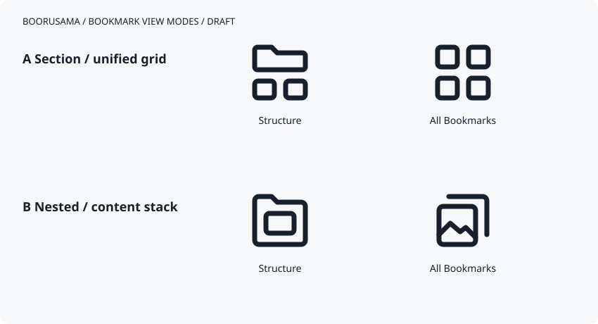

# Bookmark view icons

**Approved:** the user selected family A for Structure and Unified. Family B is
an archived alternative. The [remediation contract](../2026-11-08-bookmark-review-remediation.md)
owns the corresponding behavior; the global All Bookmarks destination is separate.

| Mode | Editable source | App asset | Penpot component name |
| --- | --- | --- | --- |
| Structure | [Section and direct items](a-structure.svg) | `assets/icon/bookmark_view_structure.svg` | `Bookmark view / Structure` |
| Unified | [Uniform content grid](a-all.svg) | `assets/icon/bookmark_view_unified.svg` | `Bookmark view / Unified` |

Both icons are transparent 24x24 SVGs with a 1.75-unit rounded stroke and editable
paths/rectangles. They contain no bitmap, font, script or external dependency.
The app applies its semantic foreground color through the existing SVG renderer.
The icon depicts the current mode; localized tooltip announces the destination
and semantics expose the current mode. Persisted `allBookmarks` values remain
compatible. Unified includes saved remote Group references as individual items
without recursively fetching their members.

Penpot editing was attempted during this continuation, but its MCP server
reported no connected Penpot instance. Actual component import/publication and
visual verification in Penpot remain open. Import the two selected sources and
use the exact component names above; do not publish the comparison board as a
single icon or present family B as awaiting selection.

