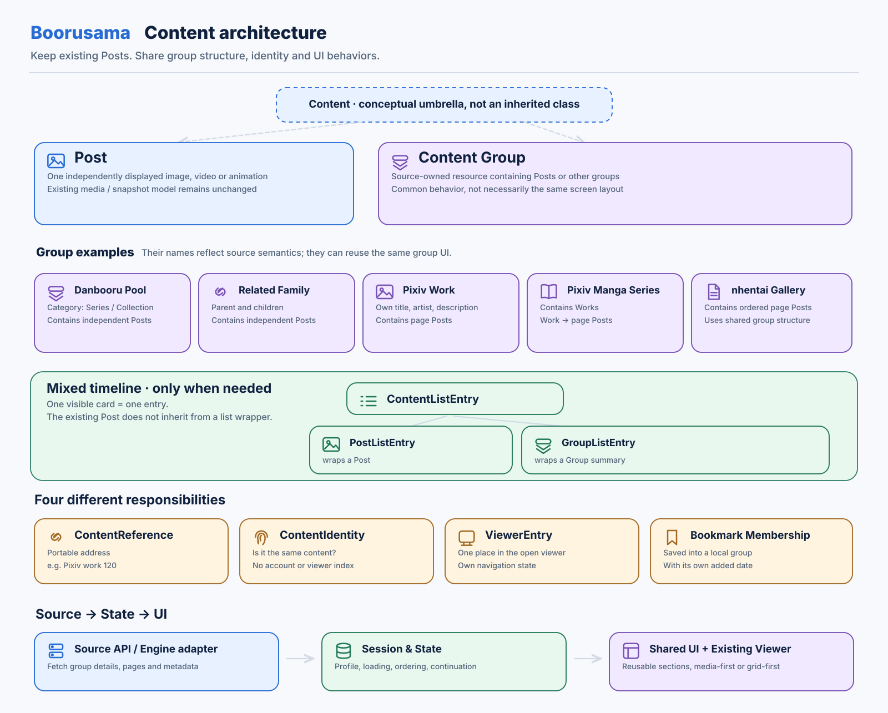
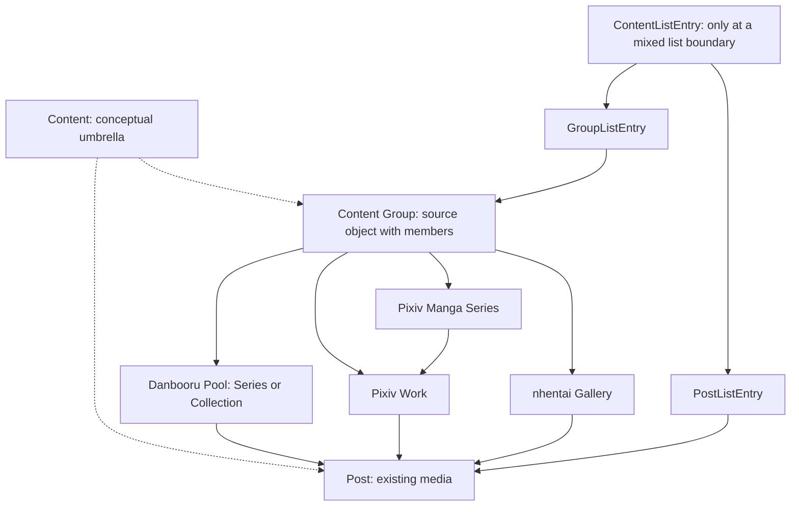
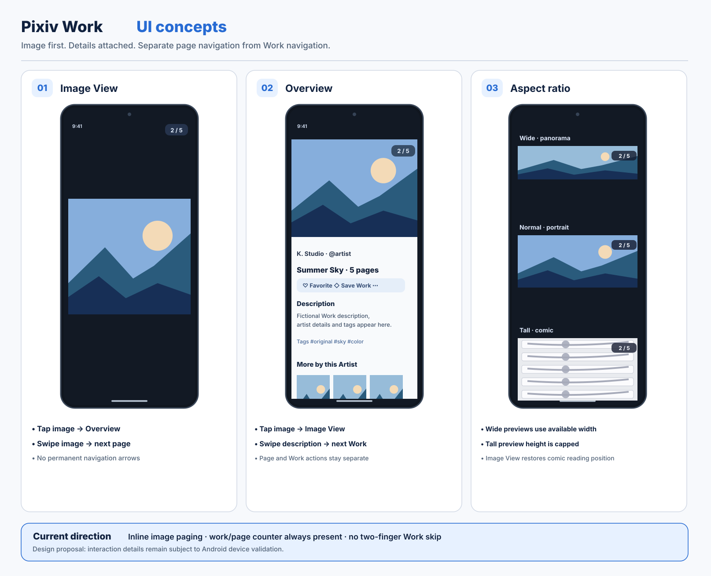
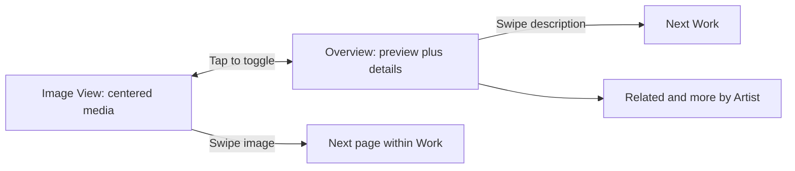

# Architecture and Pixiv Work: Editable Diagram Comparison

**Design experiments, not approved runtime architecture or UX.** These hand-recreated vector diagrams preserve the key ideas of the earlier generated concept posters; they are not pixel-exact conversions.

Read the [diagram style guide](../diagram_style_guide.md).

## New: native HTML/CSS layout experiment (2026-11-05)

[Open the structure-first comparison](content-native-html.html). It contains **both diagrams in a single standalone HTML file**, built with ordinary HTML cards and CSS Grid/Flexbox. There is **no embedded SVG**. Three remote HTTPS photo URLs are reused in architecture cards and Pixiv Work phone views; you can substitute your own HTTPS image URL. Image bytes are not stored in the repository.

This addresses the user's feedback: **Soft Pastel is the preferred palette, but the more important comparison is information structure and layout**. The earlier draw.io and Mermaid reproductions were visually unsatisfactory for these two explanation posters; retain them as historical experiments, not required future outputs. External image failure leaves an intentional placeholder.

## Architecture: Post, remote Groups and mixed listings

| Method | File | Why use it |
| --- | --- | --- |
| **SVG** | [architecture.svg](architecture.svg) | Direct GitHub rendering; native shapes and text |
| **draw.io** | [architecture.drawio](architecture.drawio) | Editable shapes and connectors in diagrams.net |
| **Mermaid** | [architecture.mmd](architecture.mmd) | Minimal text source, excellent diffs |
| **HTML + inline SVG** | [architecture-inline.html](architecture-inline.html) | Single offline file with visual theme comparison |

Style variants: [Soft Pastel](architecture.svg), [Editorial Neutral](architecture-editorial.svg), [Night Blueprint](architecture-night.svg).

### Mermaid architecture

## Pixiv Work UI: Image View, Overview, page ratios

| Method | File | Why use it |
| --- | --- | --- |
| **SVG** | [viewer.svg](viewer.svg) | Diagrammatic editable phone regions |
| **draw.io** | [viewer.drawio](viewer.drawio) | GUI-editable simplified phone sections |
| **Mermaid** | [viewer.mmd](viewer.mmd) | Behavior and gesture flow, not screenshot layout |
| **HTML + inline SVG** | [viewer-inline.html](viewer-inline.html) | Offline comparison of three visual styles |

Style variants: [Soft Pastel](viewer.svg), [Editorial Neutral](viewer-editorial.svg), [Night Blueprint](viewer-night.svg).

### Mermaid viewer

## Format verdict

**SVG** is the practical documentation default for visual explanations. **draw.io** is best when human GUI manipulation of every block matters. **Mermaid** is the smallest and easiest to review in Git, but cannot accurately recreate a complex phone concept sheet. **HTML/SVG** works best for interactive experiments and theme variants.

The SVG and draw.io examples use real edit-friendly vector objects, not an embedded PNG. The draw.io layout is a simpler approximation and still needs manual inspection in diagrams.net. Mermaid was not run through a dedicated renderer. No source images or fonts are bundled.
